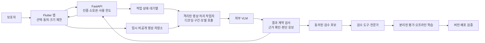

# PetSense AI — 개 전용 MVP 제품·아키텍처 기획

작성: 2026-10-18. 상태: **권장 설계 및 실행 계획**. 이 문서의 목표·API·인프라는 구현 완료를 뜻하지 않는다. 기존 완료 내역은 tasks/todo.md, 검수 도구는 REVIEW_UI.md, 로컬 미디어 검증은 VIDEO_MEDIA.md를 참고한다.

## 1. 권장 방안

초기에는 **Flutter 앱에서 사용자가 선택한 짧은 개 영상 → PetSense API → 외부 VLM → 출처 구간이 있는 관찰 결과**로 하나의 사용 흐름을 완성한다. 실제 성능과 비용을 확인한 다음 폰의 소형 탐지기로 전송 구간을 줄인다. 충분한 검수 데이터가 쌓이면 자주 쓰는 행동을 전용 모델로 처리한다.

현재 조건에서 가장 적합한 선택이라는 판단이다. 실제 모델 비교와 사용자 검증으로 수정한다. 대형 VLM을 직접 학습하거나 GPU 서버를 상시 운영할 근거는 아직 없다.

### 대안 비교

| 대안 | 이점 | 주요 제약 | 결정 |
|---|---|---|---|
| 앱에 외부 API 키를 넣어 직접 호출 | 빠른 시제품 | 키 추출·비용 통제·접근 관리 어려움 | 채택하지 않음 |
| 모든 영상·오디오를 계속 서버로 전송 | 긴 맥락 확보 | 비용·프라이버시·업로드·배터리 부담 | 초기 범위에서 제외 |
| 대형 VLM을 폰에서 실행 | 외부 전송 감소, 오프라인 가능성 | 기기별 메모리·발열·품질·배포 검증 필요 | 후속 비교 실험 |
| 자체 GPU VLM 서버 | 배포·버전 통제 | GPU 비용·운영·유휴 자원 부담 | 사용량·품질 근거 확보 후 검토 |
| 짧은 사용자 선택 영상 + 서버 VLM | 비교 실험과 제품 검증이 쉬움 | 외부 API 비용·제공자 의존 | **MVP 채택** |
| 폰의 경량 감지 + 필요한 구간만 서버 분석 | 전송량·반복 호출 감소 가능 | 이벤트 누락·시간 동기화 검증 필요 | **2단계 목표** |

## 2. 제품 범위와 화면

첫 사용자: 자기 개의 특정 장면을 이해하고 기록하려는 보호자. 홈캠 상시 감시, 다중 동물 추적, 고양이, 감정 번역, 질병 진단 및 교정 성공 판정은 초기 범위에서 제외한다.

**핵심 질문:** “이 짧은 영상에서 우리 개가 무엇을 하고 있고, 어떤 부분은 확실히 말하기 어려운가?”

1. 개 프로필: 가명 pet_id, 보호자 소유 관계. 견종·나이 등은 선택 항목이며 프로필 추정으로 관찰을 덮어쓰지 않는다.
2. 영상 선택: 10–20초 권장, 최대 30초·20 MB를 초기 제안값으로 둔다. 서비스 분석 동의와 학습 이용 동의를 별도로 보여준다.
3. 처리 상태: 업로드/처리/완료/유보/실패를 구분한다. 취소·삭제 가능. 결과가 늦어도 중복 과금되는 새 작업을 만들지 않는다.
4. 결과: 관찰한 행동, 해당 시간 구간, 관찰하기 어려운 점을 우선 표시한다. 예: “03–06초: 앉은 자세”, “뒤쪽이 가려져 꼬리는 확인하기 어렵습니다.”
5. 피드백: “맞음/수정 필요” 및 선택 설명. 보호자의 피드백은 정답 확정이 아니라 검수 후보로 취급한다.
6. 기록: 원본 보관과 분리된 결과 저장·삭제. 원본 만료 후에는 재생 불가를 명시한다.

초기 라벨은 `standing`, `sitting`, `lying`, `walking`부터 검증한다. 시간적 근거가 부족한 walking은 보류한다. 나머지 기존 검수 라벨은 데이터 준비용이며 출시 지원을 의미하지 않는다. 공격성·불안·분리불안·통증은 MVP 예측 라벨에 넣지 않는다. 교정 안내가 필요하면 이후 전문가가 승인한 지침 검색을 별도 기능으로 추가한다.

## 3. 구성과 책임

| 구성 | 책임 | 초기 운영 방식 |
|---|---|---|
| Flutter 앱 | 촬영·선택·동의·재생·결과·삭제 | 먼저 개발 기기 1종에서 E2E 확인, 이후 Android/iOS 검증 |
| FastAPI | 개인별 인증, pet 소유권, 작업 상태, 비용 예약 | 기존 서비스 확장. 공유 개발 토큰은 출시 앱에서 사용 금지 |
| 비공개 객체 저장소 | 만료되는 원본 업로드 | 고유한 업로드 경로, 짧은 만료 서명 URL, 서버 측 크기·파일 검증 |
| PostgreSQL | 사용자·동의·작업·결과·버전·예산 원장 | 운영 데이터. 기존 SQLite 지식 DB는 개발용 관리 도구로 분리 |
| 작업자 | 디코딩, VLM 호출, 결과 검사 | 별도 프로세스/컨테이너, 제한된 CPU·메모리·시간·네트워크 |
| 작업 대기열 | 재시도·중복 방지·취소 | 초기 PostgreSQL 작업 테이블과 lease부터; 부하 근거가 생기면 전용 큐 |
| 모델 제공자 | 영상 또는 시간표시 프레임 관찰 | 초기 한 제공자를 우선 연결. 다른 제공자는 동일 평가 세트의 비교 후보 |

처음부터 Kubernetes, 여러 마이크로서비스, 벡터 DB, GPU 클러스터를 도입하지 않는다. API + 작업자 + 관리형 DB/저장소면 첫 운영 실험에 충분한지 먼저 확인한다.

## 4. VLM 입력·출력 계약

기존 Gemini URL 분석 코드는 교육 영상의 지식 수집 경로다. 사용자 비공개 영상 업로드 경로가 이미 구현된 것으로 취급하지 않는다. 기존 OpenAI 어댑터는 단일 이미지용이며 시간적 행동 분석과 같지 않다.

모델 이름·버전은 호출 시점에 공식 API 지원 여부, 가격, 데이터 보존 조건을 확인하고 고정한다. 기존 Gemini 영상 경로를 첫 어댑터 후보로 삼되 성능 우위를 가정하지 않는다. 동일 작업의 네이티브 영상 입력과 시간표시 프레임 입력을 구분해 평가한다. 공급자를 바꿀 때 사용자 동의·데이터 조건과 비용을 다시 확인한다.

- 입력: clip_id, 실제 컨테이너 시간 기준 길이, 타임스탬프를 보존한 영상/프레임, 필요한 최소한의 프로필 정보.
- 프레임 실험: 균일 샘플링과 사건 중심 샘플링을 비교하되 드문 프레임만으로 움직임을 단정하지 않는다. VFR과 누락 프레임은 원본 PTS로 매핑한다.
- 출력: schema_version, model_version, prompt_version, species, observations[{label,start_ms,end_ms,evidence_frame_ids}], visibility, abstained, abstention_reason.
- 가설: 관찰과 다른 필드에만 저장하며 첫 사용자 화면에서는 검증 전 감정 가설을 기본 숨김 처리한다.
- 검사: 허용된 행동만, 0 ≤ start < end ≤ clip duration, 존재하는 프레임 참조만, 개가 아니거나 여러 동물의 대상이 불명확하면 유보.
- 시간·라벨 스키마 검사는 환각 방지를 보장하지 않는다. 전문가 대조 평가가 별도로 필요하다.
- VLM self-confidence를 확률이나 정확도로 표시하지 않는다. 현재 .6 임계값은 임시 구현이며 출시 기준은 검증 세트에서 보정·확정한다.

품질 미달·실패 시 추정 설명을 생성해 채우지 않는다. 외부 API 실패와 관찰 불충분은 각각 `failed`와 `abstained`로 구분한다. 오디오는 별도 모델의 사건 결과로 제공하고, 영상과 다른 결론이면 숨기지 않고 유보한다.

## 5. 서버 API와 작업 상태 — 신규 제안

| API | 기능 | 주요 검증 |
|---|---|---|
| POST /v1/analysis-jobs | 작업 생성·업로드 허가 | 사용자/개 소유권, 동의 버전, 크기 제한, idempotency key, 예산 예약 |
| POST /v1/analysis-jobs/{id}/submit | 업로드 완료 후 작업 예약 | 서버 확인 파일 크기/형식, 체크섬, 작업 소유권 |
| GET /v1/analysis-jobs/{id} | 상태·결과 확인 | 사용자별 접근 통제, 원본 URL/키 로그 금지 |
| DELETE /v1/analysis-jobs/{id} | 취소·삭제 요청 | 미실행 작업 중지, 실행 중 결과 게시 억제, 파일·파생 데이터 삭제 추적 |
| POST /v1/analysis-jobs/{id}/feedback | 결과 피드백 | 대상 소유권, 버전·시각, 학습 동의와 분리 |

상태: `awaiting_upload → queued → processing → completed / abstained / failed`.
`cancel_requested → cancelled`, `delete_requested → deleted`는 실행 중 경합을 처리한다. 외부 API 호출이 이미 전송되면 비용·전송 자체를 되돌릴 수 없으므로 재호출을 막고 결과 게시/보존을 중지한다.

첫 연결 작업은 인증된 내부 평가 CLI로 비공개 샘플 하나를 분석하는 것으로 시작한다. 성능·비용을 확인하기 전 전체 운영 API를 모두 만들지 않는다.

## 6. 비용·응답 시간·장애

초기 운영 한도는 정책 값으로 제안하며 과금 승인이나 현재 적용값이 아니다.

- 세션당 최대 30초·20 MB, 하루 사용자별 상한 및 전체 예산은 운영 설정으로 지정한다.
- 사용자 중복 요청은 idempotency key로 같은 작업을 돌려준다. 내용 해시 재사용은 사용자/동의/모델/프롬프트 범위 안에서만 한다.
- 외부 호출 전 비용 상한을 원자적으로 예약한다. 토큰·영상 길이·재시도 사용량을 수집해 정산하고, 예산을 초과하면 호출하지 않는다.
- 재시도는 재시도 가능한 오류에 한정한다. 최대 1회와 작업 전체 deadline을 초기값으로 두고, 결과가 불명확한 요청은 공급자 지원 여부에 따라 조회·재조정한다. 무조건 재호출하지 않는다.
- 1차 응답 시간 목표: **업로드 완료부터 결과까지 p95 30초 이내**. 촬영·압축·업로드 시간과 구분해 각각 보고한다. 측정 전 달성을 주장하지 않는다.
- 서비스 화면에는 대기·진행·실패·재시도를 명확히 표시한다. 장시간 지연 시 성공처럼 보이는 빈 결과를 반환하지 않는다.

월 비용 계산:
`월 작업 수 × (평균 VLM 비용 + 디코딩 비용 + 저장/전송 비용) + DB/API/모니터링 고정비 + 실패·재시도 비용`.
월 작업 수는 `활성 사용자 수 × 사용자당 일 작업 수 × 사용 일수`로 계산한다. 공급자 가격이 확인되지 않은 현재 원화 비용이나 손익분기 사용자 수를 확정하지 않는다.

첫 100개 실제 요청에서 모델별 입력/출력 사용량, 실패율, p50/p95, 건당 비용을 기록한다. 자체 호스팅 비교는 같은 품질·동시성에서 GPU/운영/유휴 비용까지 포함한다.

## 7. 개인정보·보존·동의

- 영상 분석 동의와 연구/학습 동의를 분리한다. 학습 동의 없이도 유료·무료 분석 기능을 사용할 수 있게 한다.
- 초기 제안 보존: 원본은 처리 후 삭제하고 장애 복구용 최대 24시간 TTL. 사용자가 원본 보관을 선택하는 기능은 후속이다. 결과는 사용자가 삭제하거나 정해진 보존기간이 지나면 삭제한다.
- 외부 제공자 업로드 파일·로그 보존은 우리 저장소 TTL과 별개다. 실제 계약·API 조건을 확인하고 사용자 고지·삭제 작업에 반영한다. 기존 `store=False` 하나로 모든 보존이 사라진다고 설명하지 않는다.
- 학습용 사본은 별도 동의·자료 권한·만료·목적을 기록한다. 철회 시 대기열과 다음 학습에서 제외하고 모델 provenance에 삭제 영향을 추적한다. 이미 학습된 가중치에서 즉시 완전 제거된다고 약속하지 않는다.
- 브라우저/앱에는 공급자 키를 넣지 않는다. 배포 환경의 비밀 관리자로 주입한다. 소비자 ChatGPT/Claude/Gemini 구독을 API 이용권과 동일하게 취급하지 않는다.
- 소유권 검사 없는 공유 pet_id/파일 URL은 금지한다. 원본 URL, 프레임, 음성, 토큰을 운영 로그에 기록하지 않는다.
- 영상 디코딩은 현재 CLI와 달리 비신뢰 업로드를 처리할 격리 환경·자원 제한·네트워크 통제가 필요하다.
- 초기에는 녹음에서 음성 대화를 별도로 전사하지 않는다. 사람·집 안 장면 전송을 최소화한다. 가림/블러는 정확도·실패 모드를 평가한 후 제공한다.

## 8. 실제 데이터 평가와 출시 게이트

### G0: 문제를 이해하는 소규모 평가

사용 권한이 있는 **5–10개체·50–100개 클립**을 첫 탐색 목표로 둔다. 이는 통계적 출시 검증용이 아니다. 전문가가 4개 행동의 정의, 복수 행동 허용 여부, 구간 경계, 판단 불가 조건을 정한다. 전문가는 VLM 예측을 보기 전에 정답을 작성한다. 최소 일부는 두 명이 독립 검수하고 불일치를 조정한다. 데이터가 부족하면 목표를 축소하고 제한을 기록한다.

먼저 API VLM 1개를 실제 실행한다. 정지 자세·시간적 행동을 구분하고 가림, 역광, TV 속 개, 사람만 등장, 고양이, 다중 동물, 무음·생활 소음 등 실패 조건을 포함한다. 공개 방송 설명의 정답 여부는 별도이며 제품 평가 데이터의 대체물이 아니다.

### G1: 고정된 성능 평가

탐색 결과로 라벨 계약을 고정한 뒤, 다른 동물·가정·촬영 세션을 포함한 평가 자료를 확보한다. 개체뿐 아니라 가정/원본/유사 영상 연결 관계를 묶어 분할한다. 동일 동물이 다른 소유자 영상으로 들어오는 경우도 추적한다. validation에서 모델·프롬프트·임계값을 선택하고 test는 최종 결정에만 사용한다. 반복 개발용 benchmark와 최종 test를 분리한다.

초기 **목표 제안**: 지원 행동 macro F1 ≥ .80, 각 행동 F1 ≥ .65, 유보하지 않은 결과의 정답률 ≥ .90와 coverage ≥ .70를 동시에 만족. 지표 정의·표본 수·유보 처리 방법을 실행 전에 동결한다. 이 숫자는 성능 약속이 아니다. 작은 표본에서 점수만 넘었다고 출시하지 않으며 개체/가정 단위 bootstrap 신뢰구간과 사례 수를 함께 검토한다.

보고 항목: 행동별 precision/recall/F1, multi-label confusion/error breakdown, 구간 IoU·시작/끝 오차, 유보율, coverage, 보정 지표, 개체/가림/조명별 성능, 실패율, 요청 비용·지연. 유보를 제외한 점수만 제시하지 않고 전체 대상의 누락을 함께 보고한다.

### G2: 사용자 가치 검증

소규모 보호자 파일럿에서 결과 이해도, 잘못된 해석, 삭제·동의 사용성, 재사용 의향을 확인한다. 정확도·비용·개인정보·소유권 검증을 통과하기 전 공개 출시로 확대하지 않는다. 사용자 테스트 일정과 인원은 참여자 확보 후 확정한다.

## 9. 학습과 지속 개선

1. 공개 모델은 고정 버전·라이선스·가중치 해시를 기록해 **먼저 추론**한다. AST 등 오디오는 감정 모델이 아니라 사건 분류 기준선으로 평가한다. 미설치 상태에서 연동 완료로 표시하지 않는다.
2. 서비스 피드백·권한 있는 교육 자료·직접 촬영 자료는 별도 출처로 관리한다. TV/YouTube URL은 권한 우회 수단이 아니다. 모델 출력은 약한 후보 라벨이다.
3. 자주 실패하는 상황·새로운 환경·불확실한 사례를 예산 내에서 검수 후보로 추천한다. 반복 영상은 제거하되 어려운 사례만 학습해 분포가 왜곡되지 않도록 일반 사례도 표집한다.
4. 충분한 전문가 검수 자료가 모이면 frozen embedding + 작은 행동 분류기부터 비교한다. 파인튜닝은 기준선이 해결하지 못하는 오류와 데이터 규모를 보고 결정한다.
5. 오디오-only, 영상-only, 결합 모델은 동일한 분리 평가 세트에서 비교한다. 결합이 개선하지 않으면 복잡한 모델을 채택하지 않는다.
6. 학습은 버전이 있는 snapshot에서 오프라인으로 수행한다. 품질·개체 분리·회귀·비용 게이트를 통과한 후보만 배포 검토한다. 실시간 무검수 온라인 학습은 하지 않는다.
7. 모델/프롬프트 업데이트는 shadow 평가 → 제한 배포 → 지표 관찰 → 확대 순서로 진행하고 이전 버전으로 되돌릴 수 있게 한다.

NotebookLM은 선택적인 자료 정리 도구다. 제품 추론의 필수 경로도, 모델 가중치 학습 엔진도 아니다. 기존 Enterprise 연동은 소스 등록 범위다.

## 10. 현재 구현과 새로 필요한 것

| 기능 | 현재 | 다음 |
|---|---|---|
| 영상 검수 | 로컬 /review, JSON 승인·취소·출력 | 검수 파일 재개·자동 임시 저장, 이후 역할/감사 |
| 미디어 검증 | 해시·동일 파일 중복·디코딩·초 범위 | 실제 데이터에서 필요한 유사 중복·PTS 정렬 |
| VLM | OpenAI 단일 이미지, Gemini 공개 URL 어댑터 | 비공개 실제 샘플 입력과 고정 평가 실행 |
| 오디오 | NumPy 기준선과 RMS 이벤트 데모 | 실제 사전학습 모델 추론·평가 |
| 사용자 서버 | 개발 공유 토큰 | 개인 인증·소유권·한도·비공개 업로드·작업 상태 |
| 앱 | Flutter 구현 전 | 선택 영상 분석 E2E, 이후 온디바이스 이벤트 감지 |
| 학습 | 검수·권한·분리 검사, 로컬 오디오 작업 큐 | 실제 개 자료 학습 및 독립 평가 |

## 11. 실행 우선순위

P0 평가 계약 → P1 검수 작업 재개 → P2 실제 VLM 평가 CLI → P3 기준 성능/비용 보고가 첫 체크포인트다. P0/P1은 API 인증 없이도 진행할 수 있다. P2/P3은 인증·API 비용 범위·허가된 실제 자료가 필요하다.

통과 후 P4 인증/업로드 → P5 작업자/결과 → P6 Flutter 사용자 선택 영상 흐름을 구현한다. 다음으로 P7 폰 이벤트 감지와 전용 모델을 실험한다. 자세한 작업별 완료 기준은 tasks/todo.md의 “하이브리드 개 MVP 실행 계획”을 따른다.

**일정은 결과 중심으로 관리한다.** 현재 자료·API·검수 인력이 확보되지 않아 출시 날짜를 확정하지 않는다. 자동화 기능의 개수보다 첫 실제 평가 보고서와 사용자 한 명이 성공적으로 영상을 분석하는 흐름을 우선한다.
