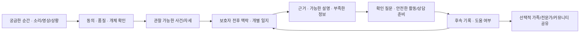

# 글로벌 제품·AI 개발 설계와 실행 순서

2026-10-31 한국 시간. 세계적 사용을 위한 목표 설계이며 현재 구현과 구분한다. 국내 PC/서버 기반 베타에서 시작하고 GitHub는 소스·CI로 사용한다. 서비스 데이터 저장·추론·운영 책임은 별도 인프라에 있다.

## 제품 흐름과 책임

클라이언트는 녹음/선택 구간·동의·언어·로컬 표시/내보내기, 서버는 계정/권한·보관·작업 큐·모델 버전·사용량/삭제, 모델 worker는 관찰 점수, 근거 서비스는 출처가 확인된 지식/설명, 사람 검수는 라벨·콘텐츠·경계 사례를 담당한다. LLM이 원본 관찰 사실이나 건강 판정을 임의 생성하지 않도록 구조화 결과 계약과 보류 상태를 우선한다.

## AI 정확도 확보
|단계|예측할 것|비교·측정·출시 조건|
|---|---|---|
|A 사건|짖음/하울링/낑낑거림 등 관찰 가능한 소리|AST 기준, 개 전용 표현 후보; 이벤트 F1·오탐/시간·잡음/비개·개체별 성능|
|B 움직임|걷기·앉기·눕기·서성거림 등 시간 구간|자세 모델/경량 VLM과 규칙 기준; 구간 F1/IoU·품종/시야별 누락·실패/보류|
|C 맥락|관찰과 전후 상황을 바탕으로 확인할 설명/질문|관찰 정답과 전문가 합의 범위를 분리, 근거 부합·사실 오류·유해 조언·불확실성·사람 도움 평가|
|D 개인 변화|같은 개·조건·관측 시간에서 평소 대비 차이|충분한 기준 기간/관측량 확보 전 미제공; 관측 누락·촬영 선택 편향·오탐/가정·주 측정|
|E 실행 도움|활동/상담 준비의 유용성|재방문·체감 도움/지원 부담과 가능하면 통제 비교; 기록 수 증가를 상태 개선으로 계산하지 않음|

정확도 목표 수치는 자료/라벨 정의 후 **잠금 평가 전에** 승인·고정한다. 전체 정확도 하나 대신 클래스별 정밀도/재현율·macro F1·혼동행렬·보정(ECE/Brier)·risk/coverage·95% 구간을 보고한다. 서로 다른 개체·가정·원본·촬영/녹음 세션을 분리하고 최종 시험 세트를 개발 튜닝에 쓰지 않는다. 한국/영어권·품종/체형·연령·기기/언어별 하위 집단을 보고하며 반복 클립을 독립 개로 세지 않는다. 소수 집단 자료가 부족하면 해당 범위를 지원했다고 광고하지 않는다.

독립 검수자는 모델 답을 보지 않고 관찰 라벨을 만든다. 전문가는 라벨 정의·갈등·위험/표본 검수에 집중할 수 있다. 보호자 의도 추정·댓글·방송 해설·AI 생성 답은 확정 정답이 아니다. 학습 자료 권리·상업 이용·개체 매핑·동기화·원본 지문을 버전 관리한다. 공개 논문이나 영상 URL만으로 학습 권리가 생기지 않는다. 사용자 분석/공유 동의와 학습 동의는 별도다.

현 단계 AST는 원본7개 사건 점수, VLM은 기존 합성 학습 준비 검증이다. 실제 개 행동 정확도·자유 의도 해독을 입증하지 않았다. 연구 후보는 라이선스 확인→오프라인 재현→동일 잠금 분할 비교→오류 검토→제한 베타 순으로 추가하며 자동 운영 모델 교체는 하지 않는다.

## 데이터와 권한 목표 설계
향후 도메인은 Household/Member/Role, Dog, ObservationCase, MediaSegment, ModelObservation, GuardianContext, Hypothesis, SourceReference, CareAction, FollowUp, ShareGrant, CommunityPost/Moderation이다. 관찰(사실)·보호자 진술·모델 가설·후속 결과를 다른 필드/출처로 보존한다. 모델 재평가가 원래 보호자 입력을 덮어쓰지 않는다. 현재 notes는 이름/상황 문자열이며 이 전체 구조가 구현된 것은 아니다.

가족/기관 공유는 명시적 초대·수락·역할·만료/철회가 전제다. 공개 피드와 학습용 데이터셋은 비공개 일지에서 자동 복제하지 않는다. 공유 링크는 범위 최소화·만료·철회·접근 확인을 갖추기 전 제공하지 않는다. 원본 미디어 TTL·관찰 일지의 선택적 장기 보관·계정/백업 삭제를 구분한다. 장기 일지를 위해 기존30일 보관을 알림 없이 늘리지 않는다.

## 글로벌 기술 기반
- 모든 시각은 UTC로 저장하고 IANA 시간대로 표시한다. 지역별 일일 분석 상품 한도와 서버 UTC 보호 한도는 별도 계약이다. 언어/국가/통화/단위는 독립 설정이다.
- 한국어/영어 핵심 흐름부터 번역 키·용어집·누락 검사·긴 문장/작은 화면·키보드/스크린리더를 확인한다. 이후 복수형·날짜/수·RTL·현지 전문가 문구 검수를 확장한다. 새 일부 영어 화면을 앱 전체 다국어 완료로 부르지 않는다.
- 오프라인 초안·동기화 충돌·중복/멱등·느린 회선·미디어 재전송 비용을 설계한다. 공개 서비스는 입구 요청 제한·OS 자원 격리·worker 감시·모델/삭제 실패 알림·백업 복구 훈련이 필요하다.
- 국가별 개인정보/아동 이용·전문 서비스 자격·데이터 전송/보관·환불/정산·운영 언어 지원을 검토한 지역부터 공개한다. 법률 검토를 코드로 완료했다고 주장하지 않는다.

## 순차 실행 백로그
‘목표 기간’은 인력/데이터/운영 연결 후 산정할 계획 단위이며 확정 출시일이 아니다.

|순서|결과물|제가 진행할 부분|외부 의존성·통과 기준|
|---|---|---|---|
|G0|글로벌 전략·공식 비교·설계·우선순위|본3문서·실행 TODO|고객/개체 성능 실적과 계획 구분|
|G1|실제 웹 계정→프로필→음성 작업|가입/복구/탈퇴·쿠키·모의/실제 AST HTTPS 브라우저 CI|기능 베타 검증; 공용 배포는 별도|
|G2|한국어/영어 상황 안내 기록|전후 맥락·관찰/가설 구분·출처·계정 메모 저장·내보내기|사람 입력임을 표시, 모델 분석으로 오인하지 않는지 확인|
|G3|독립 정리/운영 확인|API와 분리된 TTL 정리·상태 확인·비식별 실행 증거|실제 국내 PC 서비스/백업 운영 연결 필요|
|G4|실제 독립 평가와 모델 비교|입수/분할/평가 코드·모델 후보 비교·오류 리포트|AI-Hub 무결성/스키마·허가 원본·독립 라벨·기기 필요|
|G5|반려견별 일지와 후속 활동|구조화 사례·시간대·내보내기·보관/삭제·확인된 활동 설계|콘텐츠 검수·선택적 장기 보관 동의·실증|
|G6|가족 돌봄/전문가 상담 패킷|역할·초대/철회·기한·전달/복구 검사|실제 제공자 자격·상담 계약/지역 운영|
|G7|안전한 주제 커뮤니티|경험/전문 답변·출처·신고/차단·번역/운영 도구|사람 모더레이션·국가별 정책·제휴 콘텐츠|
|G8|유료 실증·다지역 확대|비식별 효용/재사용·비용 계측·비교 실험 설계|고객 모집·언어 검수·결제/환불·지원/법률·실제 운영|

우선 인터뷰는 한국어/영어 각10명, 제한 파일럿은 합계30가정/4주를 **제안**한다. 실제 모집 수·통과 표본 수·예산은 아직0/미확인이고 변경 가능하다. 핵심 질문은 ‘현재 어떤 대안을 쓰며, 언제 답을 못 얻고, 기록/활동/상담 연결에 다시 돌아오는가’다. 기능 선호만으로 유료 수요를 인정하지 않는다.

## 완료의 정의
코드/단위·브라우저 검사, 실제 데이터 독립 모델 평가, 실기기 안정성, 운영/삭제/복구, 고객 효용·유료 유지가 각각 별도 완료 항목이다. 현재 증거 없는 항목은 남겨 두고, 가능한 코드·도구·문서는 순서대로 완성한다. 세계1위는 장기 결과이며 이 계획이나 단일 PR의 완료 판정이 아니다.
